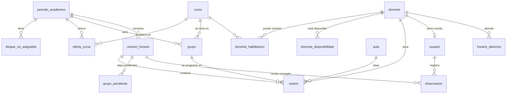

# Base de datos · Horarios UEB

Scripts SQL de la base de datos (MySQL 8). Son la **fuente única**: el backend los copia a su classpath al compilar y
**Flyway** los ejecuta solo, una vez, la primera vez que el backend se conecta a una base vacía.

| Script | Contenido |
|---|---|
| `migraciones/V1__esquema.sql` | Tablas, llaves, restricciones `CHECK` y `UNIQUE` (un docente o un aula no empiezan dos sesiones a la misma hora; un grupo no tiene dos sesiones el mismo día) |
| `migraciones/V2__datos_semilla.sql` | Plan de estudios con créditos (51 cursos + 12 electivas profesionales), 86 aulas, 55 docentes con disponibilidad y habilitaciones, periodos 2026-1 (cerrado) y 2026-2 (abierto), oferta, 319 grupos y usuarios iniciales |
| `migraciones/V3__horario_2026_1.sql` | Horario **publicado** de 2026-1 (primera versión) |
| `migraciones/V4__aulas_y_horario_2026_1.sql` | Sistemas digitales, Dinámica de sistemas y Modelos y simulación pasan a sala de cómputo; usuarios para todos los docentes; horario 2026-1 regenerado con el algoritmo actual (sábado diurno solo como último recurso, aulas repartidas, 0 violaciones) |

> [!IMPORTANT]
> No modifique un script ya aplicado en una base existente: Flyway guarda su firma y el backend no arrancaría.
> Para cambiar datos o tablas cree un script nuevo, p. ej. `V5__descripcion.sql`.

## Modelo



## Regenerar el horario semilla de 2026-1

`V4` se genera con el mismo algoritmo del backend (la clave inicial de los docentes se pasa por parámetro y en el
script solo queda su hash). Solo tiene sentido antes de que `V4` se aplique en producción:

```bash
cd Backend/horarios-ueb-back
./gradlew test --tests "*GenerarHorarioSemillaTest" -DgenerarSemilla=true "-DclaveInicial=..."
```

## Correr los scripts a mano (opcional)

Con cualquier cliente MySQL (DBeaver, MySQL Workbench) conectado a la base, ejecute `V1` a `V4` en ese orden.
Si lo hace así, el backend en producción verá tablas que Flyway no creó: en ese caso deje que lo haga el backend
(recomendado) o configure `spring.flyway.baseline-on-migrate=true` y `spring.flyway.baseline-version=4`.
