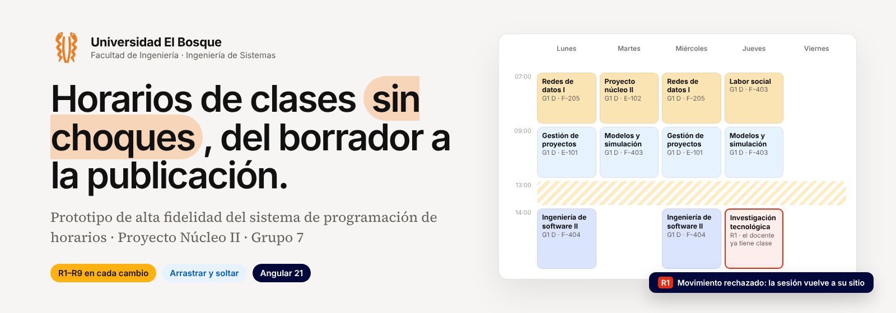
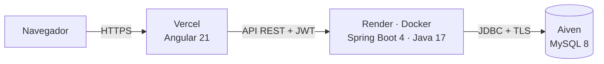

<p align="center">
  
</p>

<p align="center">
  
  
  
  
  
  
</p>

# Horarios UEB

Sistema web de **programación de horarios de clase** del Programa de Ingeniería de Sistemas de la Universidad El Bosque.
La coordinación genera una propuesta sin choques, la ajusta arrastrando sesiones en un tablero semanal (cada cambio se
valida contra las reglas R1–R9 en el servidor), el comité registra su concepto y el horario se publica; cada docente
consulta su horario y registra su disponibilidad y su horario de atención.

## Arquitectura



| Carpeta | Contenido |
|---|---|
| `Frontend/horarios-ueb` | Aplicación Angular ([README](Frontend/horarios-ueb/README.md)) · `Frontend/design/DESIGN.md` guía visual |
| `Backend/horarios-ueb-back` | API Spring Boot (`co.edu.unbosque.horariosuebback`) |
| `BD/migraciones` | Scripts SQL: esquema, datos semilla y horario 2026-1 ([README](BD/README.md)) |
| `Docs` | Enunciado, plan de estudios, entregas de la materia y material del prototipo |
| `Extras/muestras-csv` | Archivos CSV de ejemplo (válidos y con errores) para probar *Importar datos* |

### Backend (`co.edu.unbosque.horariosuebback`)

| Paquete | Qué contiene |
|---|---|
| `entity` (+ `enums`) | Entidades JPA con Lombok (solo atributos) |
| `repository` | Repositorios Spring Data JPA |
| `domain.reglas` | Reglas duras R1–R9 (patrón Specification) y `ValidadorReglas` |
| `domain.generador` | `GeneradorHorario` (interfaz) y `GeneradorVoraz`: patrones L-X, M-J, X-V, L-X-V… con balance de la semana |
| `service` | Lógica de negocio: periodos, catálogo, grupos, horario y versiones, atención, usuarios, bitácora |
| `controller` | API REST bajo `/api` con permisos por rol (`@PreAuthorize`) |
| `security`, `config` | JWT HS256, BCrypt, CORS, cabeceras, freno a fuerza bruta |
| `dto`, `exception` | Objetos de la API y manejo de errores en español |

### Seguridad

- Contraseñas con **BCrypt**; nunca salen del backend.
- Sesión con **token JWT** (8 h) firmado con un secreto que solo existe como variable de entorno (`JWT_SECRET`).
- **Permisos en el servidor**: cada endpoint exige el rol; el docente solo recibe su propio horario publicado; los
  intentos rechazados quedan en la bitácora. Desactivar un usuario o cambiarle el rol tiene efecto inmediato.
- Bloqueo de 15 minutos tras 5 intentos fallidos de inicio de sesión con el mismo correo.
- CORS limitado a la URL del front, CSP y cabeceras de seguridad en Vercel y en la API, sin trazas de error expuestas.
- Las reglas R1–R9 se validan en el servidor antes de guardar y la base de datos tiene restricciones `UNIQUE`/`CHECK`
  como segunda barrera.

## Usuarios iniciales

Todos comparten la contraseña inicial definida por el equipo (cada uno la cambia en **Mi cuenta**):

| Rol | Correo |
|---|---|
| Coordinación de horarios | `coordinacion@unibosque.com` |
| Comité | `comite.software@unibosque.com` · `comite.ciencias@unibosque.com` |
| Docentes | `gneuta@unibosque.com` · `slopez@unibosque.com` · `cvanegas@unibosque.com` · `eguillen@unibosque.com` |
| Administración | `admin@unibosque.com` |

> [!WARNING]
> El sitio es público: después de la sustentación cambie las contraseñas (sobre todo la del administrador y la de
> coordinación) desde **Mi cuenta**.

## Correr el proyecto en el computador (Antigravity)

**Requisitos:** JDK 17 (Gradle lo encuentra solo; sirve el que trae IntelliJ en `~/.jdks`) y Node.js 20.19+ o 22.12+.

1. Abra la carpeta raíz `Final-Horarios-UEB` en Antigravity (*File → Open Folder*). Acepte las extensiones
   recomendadas (Java y Spring Boot) si las ofrece; no son obligatorias.
2. La primera vez: `Ctrl+Shift+P` → **Tasks: Run Task** → **Frontend: instalar dependencias**.
3. `Ctrl+Shift+P` → **Tasks: Run Task** → **Iniciar todo (backend + frontend)**. Se abren dos terminales dentro de
   Antigravity: el backend en `http://localhost:8080` y el front en `http://localhost:4200`.

O a mano, en dos terminales de Antigravity (`Ctrl+ñ`):

```powershell
cd Backend/horarios-ueb-back
.\gradlew.bat bootRun
```

```powershell
cd Frontend/horarios-ueb
npm install
npm start
```

En local el backend usa el perfil **`local`**: una base **H2 en archivo** (`Backend/horarios-ueb-back/data/`) con el mismo
esquema y datos de MySQL, creada por Flyway al arrancar. Para empezar de cero, detenga el backend y borre esa carpeta.

Para trabajar en local contra la base de la nube:

```powershell
$env:SPRING_PROFILES_ACTIVE="prod"; $env:DB_URL="jdbc:mysql://..."; $env:DB_USER="avnadmin"; $env:DB_PASSWORD="..."; $env:JWT_SECRET="..."; $env:CORS_ORIGINS="http://localhost:4200"
.\gradlew.bat bootRun
```

Pruebas del backend: `.\gradlew.bat test` (o la tarea **Backend: pruebas**).

## Despliegue gratuito en la nube

El front va en **Vercel**, el backend en **Render** (Vercel no ejecuta Java) y la base de datos en **Aiven**.
Las tres tienen plan gratuito sin tarjeta de crédito. Orden: base de datos → backend → front.

### 1. Base de datos MySQL en Aiven

1. Cree una cuenta en [aiven.io](https://aiven.io) (puede entrar con Google o GitHub).
2. **Create service → MySQL → Free plan**. Elija la región gratuita más cercana (América del Norte) y nómbrelo
   `horarios-ueb-db`. Espere a que el estado diga **Running** (2–5 min).
3. En **Overview → Connection information** copie *Host*, *Port*, *User* (`avnadmin`) y *Password*.
4. Arme la URL de conexión (base `defaultdb`):

   ```
   jdbc:mysql://HOST:PORT/defaultdb?sslMode=REQUIRED&rewriteBatchedStatements=true&serverTimezone=UTC&characterEncoding=UTF-8
   ```

No hace falta crear tablas: el backend las crea y carga los datos la primera vez que se conecta.

> [!NOTE]
> Aiven puede **apagar** una base gratuita que pasa mucho tiempo sin uso (avisa por correo). Para encenderla:
> consola de Aiven → el servicio → **Power on**. El paso 4 evita que se duerma.

### 2. Backend en Render

1. Suba este repositorio a GitHub (ver más abajo).
2. Cree una cuenta en [render.com](https://render.com) con GitHub.
3. **New → Blueprint** → elija el repositorio. Render lee `render.yaml` y propone el servicio `horarios-ueb-back`
   (Docker, plan Free). Complete las variables:
   - `DB_URL`, `DB_USER`, `DB_PASSWORD`: los de Aiven.
   - `JWT_SECRET` se genera solo; `CORS_ORIGINS` ya trae `https://horarios-ueb-sistema.vercel.app`.
4. **Apply**. La primera compilación tarda 5–10 min. Pruebe `https://horarios-ueb-sistema.onrender.com/api/salud`:
   debe responder `{"estado":"ok"}`.

> [!IMPORTANT]
> Si Render le asigna otra URL al servicio (porque el nombre ya existe), cámbiela en
> `Frontend/horarios-ueb/src/environments/environment.production.ts` y en `connect-src` de
> `Frontend/horarios-ueb/vercel.json`, y haga commit.

En el plan gratuito el servidor se **duerme tras 15 min** sin uso y tarda ~1 min en despertar; la pantalla de inicio
de sesión lo despierta y muestra «Conectando con el servidor…».

### 3. Front en Vercel

1. En [vercel.com](https://vercel.com): **Add New → Project** → importe el repositorio.
2. **Project Name:** `horarios-ueb-sistema` · **Root Directory:** `Frontend/horarios-ueb` (Vercel detecta Angular y usa `vercel.json`).
3. **Deploy**. Luego **Settings → Environments → Production → Branch Tracking:** `main`. Los pushes a `develop`
   generan despliegues de vista previa con otra URL.
4. La URL de producción es `https://horarios-ueb-sistema.vercel.app`. Si cambia, póngala en la variable
   `CORS_ORIGINS` de Render (separe varias con comas).

### 4. Mantenerlo despierto (opcional)

En [cron-job.org](https://cron-job.org) cree una tarea gratuita que llame cada 10 minutos a
`https://horarios-ueb-sistema.onrender.com/api/salud`. Mantiene despiertos el backend y la base de datos (Render da
750 horas gratis al mes, suficientes para un servicio encendido todo el mes).

Cada `git push` a `main` vuelve a desplegar Render y Vercel automáticamente.

## Reglas del negocio

| Regla | Qué impide |
|---|---|
| **R1** · **R2** | Un docente o un aula con dos sesiones a la vez |
| **R3** | Sesiones fuera de la franja hábil o sobre el almuerzo (13:00–14:00) |
| **R4** | Aulas sin la capacidad o las características que pide el curso |
| **R5** · **R6** · **R7** | Docentes no habilitados, fuera de su disponibilidad o por encima de sus horas máximas |
| **R8** | Más sesiones de las permitidas o dos sesiones del mismo grupo el mismo día |
| **R9** | Grupos con cupo por encima de 40 + 10 % |

Las restricciones blandas B1–B6 (días seguidos, huecos, carga desbalanceada, cruces del semestre, aulas especiales mal
aprovechadas y dos grupos diurnos con el mismo docente) se informan y no bloquean la publicación.

---

<p align="center">
  <br>
  <sub>Proyecto Núcleo II · Universidad El Bosque · Programa de Ingeniería de Sistemas</sub>
</p>
